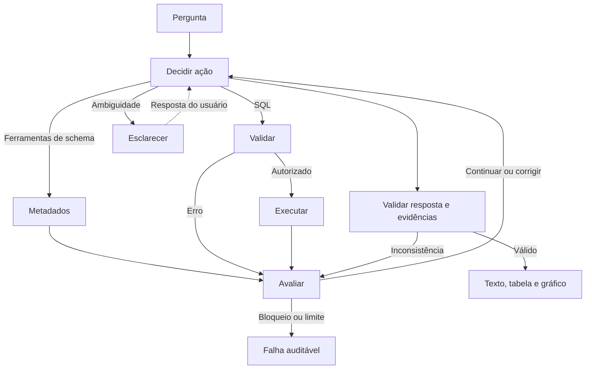

# Franq · Assistente Virtual de Dados

Implementação do Desafio 1: investigação de um SQLite por perguntas em português,
com SQL dinâmico, evidências, tabelas e gráficos. O banco privado não é distribuído.

## Tecnologias

Python 3.12 permite tipagem e testes simples; LangGraph controla o ciclo de investigação;
LangChain integra o modelo e as ferramentas; SQLite dispensa serviços externos;
Streamlit oferece a interface local. Pydantic valida contratos, SQLGlot inspeciona SQL,
Pandas/Plotly apresentam resultados e Pytest/Ruff verificam o projeto.

## Configuração e execução

Na raiz do projeto, com Python 3.12 instalado:

```bash
python -m venv .venv
```

Ative com `.venv\Scripts\Activate.ps1` no PowerShell ou `source .venv/bin/activate`
no Linux/WSL. Depois:

```bash
python -m pip install -r requirements.lock
python -c "from pathlib import Path; p=Path('.env'); p.exists() or p.write_bytes(Path('.env.example').read_bytes())"
python -m streamlit run app.py --server.address 127.0.0.1
```

Abra **http://localhost:8501** no navegador do Windows, inclusive ao executar no WSL.
Mantenha o terminal aberto; `Ctrl+C` encerra o servidor. A aplicação escuta apenas localmente.
Após atualizar o código (ex.: `git pull`) ou o `.env`, encerre com `Ctrl+C` e execute de novo:
o Streamlit mantém em memória os módulos de `src/` já carregados.
Períodos relativos usam os dados mais recentes do banco: “em maio” sem ano é o maio mais
recente com registros e “último ano” são os 12 meses até o último registro. A resposta informa
o período considerado.
No primeiro início, deixe o campo de e-mail do Streamlit vazio, se solicitado.

Antes de abrir a aplicação:

1. Coloque `anexo_desafio_1.db` na raiz do projeto (ou ajuste `DATABASE_PATH` no `.env`).
2. No `.env`, preencha `OPENAI_API_KEY` com sua chave e defina `ENABLE_PAID_API=true`.

Com `ENABLE_PAID_API=false` (padrão), a interface abre, mas não envia perguntas à OpenAI.
Os testes não precisam de chave nem fazem chamadas à API.

Modelo padrão: `gpt-5.4-mini-2026-03-17`, configurável por `OPENAI_MODEL`.
A aplicação limita o gasto local a US$ 0,50 (`API_BUDGET_USD`), registrado em
`.local/usage.sqlite`; ao trocar de modelo, ajuste também `INPUT_PRICE_PER_MILLION` e
`OUTPUT_PRICE_PER_MILLION`.

## Arquitetura



`src/agent.py` implementa o `StateGraph`; `tools.py` expõe ferramentas LangChain;
`database.py` descobre tabelas, colunas, FKs e relações candidatas sem schema fixo.
`models.py` define os contratos; `config.py` centraliza limites;
`visualization.py` valida gráficos; `observability.py` registra eventos e consumo.
Checkpoints em memória retomam esclarecimentos na sessão, sem persistir conversas em disco.

SQL passa por SQLGlot, conexão `mode=ro`, `query_only` e autorizador SQLite.
Somente SELECT e funções autorizadas; escrita, múltiplas instruções, extensões,
ATTACH, PRAGMA do modelo e CTE recursiva são bloqueados. Há limites de tempo,
linhas, bytes, consultas, correções, contexto e chamadas. Erros recuperáveis voltam
ao modelo; violações de segurança encerram a execução. Vazio, truncamento e
inconsistência têm tratamentos distintos.

Tabelas e gráficos usam somente resultados executados. A resposta exige IDs válidos
e verifica números contra dados/filtros, aceitando arredondamento decimal validado
deterministicamente; isso não prova a semântica da análise.
O expansor mostra ferramentas, SQL, erros, tentativas e duração, sem raciocínio privado.
Logs JSON locais omitem prompts, SQL e linhas individuais. Histórico e consultas ficam
na sessão; não use a interface como serviço público sem controles adicionais.
Gráficos identificam sua consulta de origem, com eixos e séries validados; dados incompatíveis
permanecem em tabela. Esclarecimentos são respondidos no mesmo campo de perguntas.

Antes do modelo, meses sem ano e “último ano/semestre/trimestre/mês” são resolvidos pela
cobertura de datas descoberta no banco, e o intervalo é informado ao modelo. Ao concluir,
a evidência principal precisa ser compatível com a intenção: contagens e comparações exigem
agregação, tendências exigem agrupamento por período (e pela dimensão pedida), rankings exigem
ordenação, anos, meses e categorias citados (ex.: “reclamações”, “app”) devem constar nos
filtros. Consultas de descoberta não são aceitas como resposta; sem evidência suficiente dentro dos limites, a
interface informa que a análise não foi concluída. Cada pergunta tem ID e estado próprios;
perguntas seguintes recebem apenas perguntas e sínteses anteriores, nunca SQL ou linhas.

## Perguntas e testes

```bash
python -m pytest -q
python -m ruff check .
python -m ruff format --check .
python -m pip check
```

Os testes bloqueiam conexões de rede e usam modelos/HTTP simulados. Cobrem segurança
adversarial, descoberta, correção, múltiplas consultas, limites, evidências, gráficos,
orçamento e interface Streamlit. Testes `original` usam o banco privado quando presente;
sem ele, são explicitamente ignorados. As fixtures pequenas são exclusivas dos testes.

### Exemplos de consultas testadas

As perguntas do enunciado foram executadas pela interface com o modelo real e conferidas
com SQL independente no banco fornecido:

| Pergunta | Resultado esperado |
|---|---|
| Liste os 5 estados com maior número de clientes que compraram via app em maio. | Maio de 2025: São Paulo 6, Minas Gerais 3, Santa Catarina 3, Alagoas 2, Espírito Santo 2 |
| Quantos clientes interagiram com campanhas de WhatsApp em 2024? | 17 clientes |
| Quais categorias de produto tiveram o maior número de compras em média por cliente? | Roupas (≈2,21), Viagens (≈2,16), Livros (≈1,98)… |
| Qual o número de reclamações não resolvidas por canal? | Telefone 19, Chat 18, E-mail 14 |
| Qual a tendência de reclamações por canal no último ano? | Série mensal por canal de 23/07/2024 a 22/07/2025, em gráfico de linhas |

Também foi testada uma pergunta fora do enunciado: clientes que nunca compraram pelo App.
“Maio” e “último ano” são resolvidos pelos dados disponíveis. Os resumos de gasto e última
compra em `clientes` divergem dos eventos em `compras`; o agente deve usar os eventos.

## Limitações e melhorias

- O modelo pode gerar SQL diferente para a mesma pergunta. As validações rejeitam respostas
  inconsistentes e pedem correção, mas não garantem toda conclusão semântica; a transparência
  operacional permite conferir SQL e resultados.
- As regras de intenção são heurísticas em português e podem não reconhecer formulações incomuns.
- Relações entre tabelas inferidas por nome e tipo são hipóteses; checkpoints de conversa
  ficam em memória e desaparecem ao encerrar o servidor.
- O banner da Franq é opcional e não é distribuído; veja `assets/README.md`.

Próximas melhorias: catálogo de métricas aprovado pelo negócio, avaliação automática com um
conjunto maior de perguntas reais, cache de consultas, autenticação e política de retenção para
uso fora do ambiente local. Dependências estão fixadas em `uv.lock`; `requirements.lock` é sua
exportação para instalação com pip.
