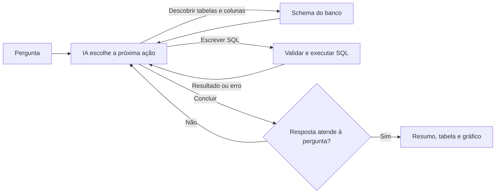

# Franq · Assistente Virtual de Dados

Desafio Técnico 1: um assistente que responde perguntas de negócio em português consultando o
banco `anexo_desafio_1.db`, com tabelas, gráficos e transparência sobre como chegou à resposta.

**Tecnologias:** Python 3.12, LangGraph, LangChain, OpenAI, SQLite, Streamlit, SQLGlot, Plotly e Pytest.

## Como executar

Pré-requisitos: Python 3.12 e uma chave da OpenAI.

1. Crie e ative um ambiente virtual na raiz do projeto:

   ```bash
   python -m venv .venv
   ```

   Ative com `.venv\Scripts\Activate.ps1` (PowerShell) ou `source .venv/bin/activate` (Linux/macOS/WSL).

2. Instale as dependências e crie o `.env`:

   ```bash
   python -m pip install -r requirements.lock
   python -c "from pathlib import Path; p=Path('.env'); p.exists() or p.write_bytes(Path('.env.example').read_bytes())"
   ```

3. Coloque o arquivo `anexo_desafio_1.db` na raiz do projeto.

4. No `.env`, preencha `OPENAI_API_KEY` com sua chave e defina `ENABLE_PAID_API=true`.

5. Inicie a aplicação e abra **http://localhost:8501**:

   ```bash
   python -m streamlit run app.py
   ```

Se o Streamlit pedir um e-mail no terminal na primeira execução, apenas pressione Enter.
`Ctrl+C` encerra o servidor. Após alterar o código ou o `.env`, reinicie-o.
Modelo padrão: `gpt-5.4-mini-2026-03-17` (`OPENAI_MODEL`); o gasto local é limitado a
US$ 0,50 (`API_BUDGET_USD`).

## Como funciona



O agente é um grafo **LangGraph**. A cada passo, o modelo da OpenAI escolhe uma ferramenta:
listar tabelas, inspecionar o schema, executar SQL, concluir ou pedir esclarecimento. Não há
consultas fixas no código: o agente descobre a estrutura do banco sozinho.

- **Correção automática:** erros de SQL, filtros com valores inexistentes (ex.: `'app'` em vez
  de `'App'`) e respostas que não atendem à pergunta voltam ao modelo para que ele corrija.
- **Segurança:** somente `SELECT`, validado com SQLGlot, em conexão somente leitura, com limites
  de tempo, linhas, consultas e chamadas ao modelo.
- **Períodos:** “maio” sem ano e “último ano” são resolvidos pelos dados mais recentes do banco,
  e a resposta informa o período considerado.
- **Transparência:** cada resposta mostra as etapas, o SQL executado, os erros e as correções.

| Arquivo | Responsabilidade |
|---|---|
| `app.py` | Interface Streamlit |
| `src/agent.py` | Grafo LangGraph: chama o modelo, executa ferramentas e valida a resposta |
| `src/tools.py` | Ferramentas disponíveis para o modelo |
| `src/database.py` | Acesso seguro ao SQLite e descoberta do schema |
| `src/intent.py` | Verifica se a consulta atende à intenção da pergunta |
| `src/presentation.py` / `src/visualization.py` | Resumo, tabelas e gráficos |
| `src/models.py` / `src/config.py` / `src/observability.py` | Contratos, configuração, logs e controle de gasto |

## Exemplos de consultas testadas

As perguntas do enunciado foram executadas com o modelo real e conferidas com SQL independente:

| Pergunta | Resultado |
|---|---|
| Liste os 5 estados com maior número de clientes que compraram via app em maio. | Maio de 2025: São Paulo 6, Minas Gerais 3, Santa Catarina 3, Alagoas 2, Espírito Santo 2 |
| Quantos clientes interagiram com campanhas de WhatsApp em 2024? | 17 clientes |
| Quais categorias de produto tiveram o maior número de compras em média por cliente? | Roupas (≈2,21), Viagens (≈2,16), Livros (≈1,98)… |
| Qual o número de reclamações não resolvidas por canal? | Telefone 19, Chat 18, E-mail 14 |
| Qual a tendência de reclamações por canal no último ano? | Série mensal por canal de 23/07/2024 a 22/07/2025, em gráfico de linhas |

## Testes

```bash
python -m pytest -q
```

Os testes usam modelos simulados e não fazem chamadas à OpenAI. Os que dependem do banco
original são ignorados se `anexo_desafio_1.db` não estiver presente.

## Melhorias futuras

- Catálogo de métricas de negócio aprovado (ex.: definição oficial de “cliente ativo”).
- Avaliação automática com um conjunto maior de perguntas reais.
- Cache de consultas e respostas frequentes para reduzir custo e latência.
- Autenticação, histórico persistente e política de retenção para uso fora do ambiente local.
