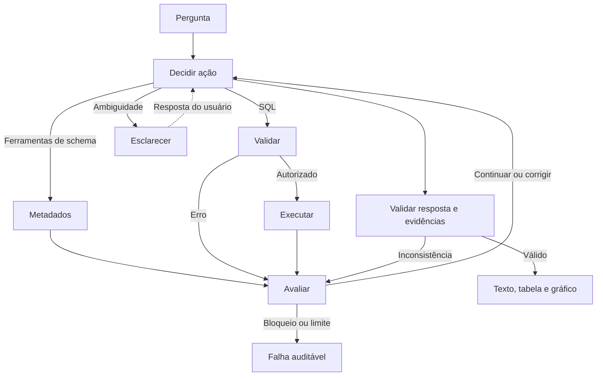

# Franq · Assistente Virtual de Dados

Implementação do Desafio 1: investigação de um SQLite por perguntas em português,
com SQL dinâmico, evidências, tabelas e gráficos. O banco privado não é distribuído.

## Tecnologias

Python 3.12 permite tipagem e testes simples; LangGraph controla o ciclo de investigação;
LangChain integra o modelo e as ferramentas; SQLite dispensa serviços externos;
Streamlit oferece a interface local. Pydantic valida contratos, SQLGlot inspeciona SQL,
Pandas/Plotly apresentam resultados e Pytest/Ruff verificam o projeto.

## Configuração e execução

Na raiz do projeto, com Python 3.12 instalado:

```bash
python -m venv .venv
```

Ative com `.venv\Scripts\Activate.ps1` no PowerShell ou `source .venv/bin/activate`
no Linux/WSL. Depois:

```bash
python -m pip install -r requirements.lock
python -c "from pathlib import Path; p=Path('.env'); p.exists() or p.write_bytes(Path('.env.example').read_bytes())"
python -m streamlit run app.py --server.address 127.0.0.1
```

Coloque `anexo_desafio_1.db` na raiz ou ajuste `DATABASE_PATH` no `.env`.
Configure `OPENAI_API_KEY` apenas localmente. `ENABLE_PAID_API=false` é o padrão:
a interface abre, mas não envia perguntas. Habilite somente após autorizar o uso pago.
Não é necessário configurar chave para executar testes.

Modelo inicial: `gpt-5.4-mini-2026-03-17`, configurável por `OPENAI_MODEL`.
O teto local inicial é US$ 0,50, independente do orçamento mensal de US$ 5.
Uma reserva conservadora precede cada chamada; consumo conhecido substitui a reserva,
e falhas sem informação de uso mantêm a reserva. O controle persiste em `.local/usage.sqlite`.
Não apague esse arquivo durante a validação. Ao mudar o modelo, atualize também
`INPUT_PRICE_PER_MILLION` e `OUTPUT_PRICE_PER_MILLION`; o controle depende dessas tarifas.

## Arquitetura



`src/agent.py` implementa o `StateGraph`; `tools.py` expõe ferramentas LangChain;
`database.py` descobre tabelas, colunas, FKs e relações candidatas sem schema fixo.
`models.py` define os contratos; `config.py` centraliza limites;
`visualization.py` valida gráficos; `observability.py` registra eventos e consumo.
Checkpoints em memória retomam esclarecimentos na sessão, sem persistir conversas em disco.

SQL passa por SQLGlot, conexão `mode=ro`, `query_only` e autorizador SQLite.
Somente SELECT e funções autorizadas; escrita, múltiplas instruções, extensões,
ATTACH, PRAGMA do modelo e CTE recursiva são bloqueados. Há limites de tempo,
linhas, bytes, consultas, correções, contexto e chamadas. Erros recuperáveis voltam
ao modelo; violações de segurança encerram a execução. Vazio, truncamento e
inconsistência têm tratamentos distintos.

Tabelas e gráficos usam somente resultados executados. A resposta exige IDs válidos
e verifica números explícitos contra dados/filtros; isso não prova a semântica da análise.
O expansor mostra ferramentas, SQL, erros, tentativas e duração, sem raciocínio privado.
Logs JSON locais omitem prompts, SQL e linhas individuais. Histórico e consultas ficam
na sessão; não use a interface como serviço público sem controles adicionais.

## Perguntas e testes

```bash
python -m pytest -q
python -m ruff check .
python -m ruff format --check .
python -m pip check
```

Os testes bloqueiam conexões de rede e usam modelos/HTTP simulados. Cobrem segurança
adversarial, descoberta, correção, múltiplas consultas, limites, evidências, gráficos,
orçamento e interface Streamlit. Testes `original` usam o banco privado quando presente;
sem ele, são explicitamente ignorados. As fixtures pequenas são exclusivas dos testes.

Referências verificadas por SQL local (não por LLM real):

- Clientes que interagiram com WhatsApp em 2024: **17**.
- Reclamações não resolvidas: **Chat 18, E-mail 14, Telefone 19**.
- Estados com mais clientes via App em **maio de 2025**, com desempate alfabético.
- Média de compras por **comprador de cada categoria**, comparada a cálculo Python.
- Reclamações mensais por canal entre **23/07/2024 e 22/07/2025**, comparadas a Python.
- Pergunta inédita: clientes que nunca compraram pelo App, validada por diferença de conjuntos.

“Maio”, “último ano” e o denominador de médias precisam de contexto explícito.
Os resumos de gasto/última compra em `clientes` divergem dos eventos em `compras`;
as análises de compras devem considerar essa limitação. O agente deve descobrir
essas condições pelos dados, não por consultas predefinidas no código de produção.

## Limitações e melhorias

Validação paga ainda pendente: mocks comprovam o fluxo, não a qualidade do modelo
na interpretação de perguntas inéditas. As checagens numéricas não detectam toda
conclusão semântica incorreta; comparar resposta, SQL e referência continua necessário.
As relações inferidas por nome/tipo são hipóteses. Checkpoints desaparecem ao encerrar
o processo. Tarifas são configuráveis e o orçamento local não cobre uso externo à aplicação.

Próximas melhorias: avaliação real progressiva, catálogo de métricas aprovado pelo negócio,
checagens semânticas adicionais e política de retenção. Dependências estão fixadas em
`uv.lock`; `requirements.lock` é sua exportação para instalação com pip.
